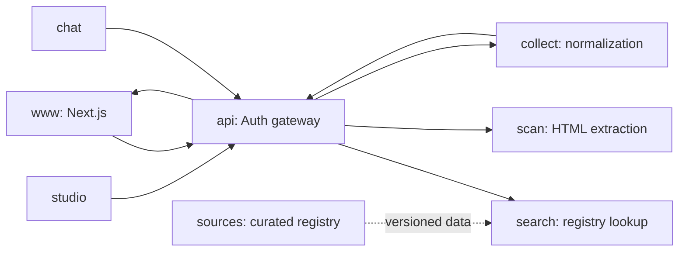

# ADR-0001: Canonical Skunky service boundaries

- Status: **Accepted for development** (not a production deployment decision)
- Date: 2026-11-20
- Owner: Skunkworks Platform Engineering

## Context

Existing repositories represent overlapping SkunkScrape versions: the `www` repository has a Next.js frontend and a separate FastAPI/Celery/PostgreSQL/Redis backend, the `api` repository has another FastAPI control-plane scaffold, `studio` has Python CLI/Tkinter tools, and `SkunkScrapeCodex` proposes a Firebase/GCP pipeline. Deleting or silently replacing these systems risks lost functionality.

## Decision

Define **Skunky** as platform family; **SkunkScrape** is a supported product.

- `www`: canonical public UI. Existing Next.js app is preserved.
- `api`: *target* control-plane/API contract, authenticated orchestration. The legacy `www/backend` remains untouched until a tested migration.
- `search`: source search against an approved, versioned registry (no arbitrary open-web discovery in V1).
- `scan`: bounded HTML extraction only in V1. A distinct network fetcher must enforce SSRF protections, robot rules, terms, rate limits, and egress isolation before crawling is added.
- `collect`: deterministic normalization, deduplication and privacy flags. No automatic outbound contact.
- `sources`: canonical schema and allowlist metadata. In V1, services use synchronized fixtures; introduce a published registry artifact as the contract matures.
- `chat`: conversation UX and authenticated, tool-bounded application integration, not an autonomous internet actor.
- `studio`: operator console and legacy local Python tools.
- `skunkscrape-integrations`: approved, opt-in outbound adapters with consent/purpose enforcement.
- `.github`: contribution policy and organization overview.

## V1 API contract

Shared schema: `source_url`, `source_id`, `source_type`, `emails`, `phones`, `provenance`, `consent_status`, `collected_at`. Personal contact information must not be exported or used for outreach without a separately established lawful basis and suppression checks.

For initial integration, the API preview accepts a bounded HTML document, verifies it against the search registry, calls scan and collect, and returns a normalized preview **without storing or dispatching leads**. Production scraper jobs remain fail-closed until approved worker execution is implemented.

## Security gates

1. Private services require authenticated service tokens and are exposed only to authorized API identity; tokens in managed secrets, never in repository files.
2. Input/output schemas, bounded payloads and no outbound fetch in the preview path.
3. No arbitrary webhook URLs, unrestricted scanning, credential-in-URL, or background scraping from untrusted input.
4. POPIA purpose limitation, source terms, robots, DNC, deletion, retention and data-subject requests for production processing.
5. Per-tenant authorization, rate limits, audit logs, idempotency, retries and dead-letter handling before unattended jobs.

## Deferred decisions

Cloud provider/deployment: **not yet selected**. Compare existing Docker Compose/PostgreSQL/Redis architecture against Cloud Run + Pub/Sub + Firestore proposal using reliability, cost, compliance and operator expertise. Do not deploy a second production stack or decommission Firebase without separate ADR and rollback acceptance.

## Migration gates

- [ ] End-to-end deterministic preview passes (search → scan → collect → API)
- [ ] API contract and client integration tested
- [ ] Secure network worker and provenance tests passing
- [ ] Approved deployment architecture and secrets inventory
- [ ] Staging performance/security tests
- [ ] Monitored production cutover and rollback plan
